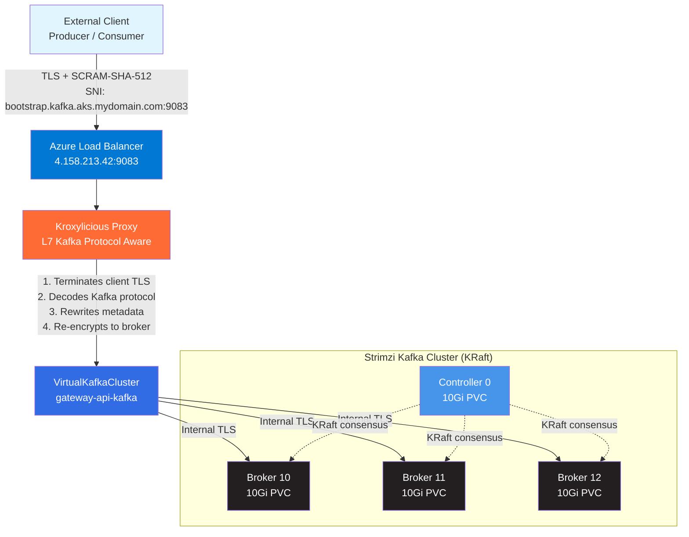

# Apache Kafka on AKS with Kroxylicious L7 Proxy

[](https://azure.microsoft.com/en-us/products/kubernetes-service)
[](https://kubernetes.io/)
[](https://kafka.apache.org/)
[](https://strimzi.io/)
[](https://kroxylicious.io/)
[](https://www.python.org/)
[](LICENSE)

Production-grade Apache Kafka deployment on Azure Kubernetes Service (AKS) using **Strimzi Operator** and **Kroxylicious** — an L7 Kafka protocol-aware proxy that terminates TLS, rewrites broker metadata automatically, and routes Kafka protocol requests via SNI. Includes a Python test suite with mock producers and consumers using SASL/SCRAM-SHA-512 authentication.

> **Migrated from Envoy Gateway (L4 TLS passthrough) to Kroxylicious (L7 Kafka protocol proxy).** See [`migrated-kroxylicious.md`](migrated-kroxylicious.md) for the full migration comparison.

---

## Key Features

- **L7 Kafka Protocol Proxy** — Kroxylicious understands Kafka wire protocol, rewrites metadata responses automatically
- **Native Strimzi Integration** — `strimziKafkaRef` auto-discovers bootstrap addresses and trusts Strimzi CA
- **Cloud-Native Architecture** — Kafka on AKS with KRaft mode (no ZooKeeper)
- **Enterprise Security** — TLS termination at proxy + re-encryption to brokers + SCRAM-SHA-512 authentication
- **Cost-Optimized** — Single Azure Load Balancer serving all brokers via SNI routing
- **Production-Ready** — 3 broker replicas, Retain storage policy, min.insync.replicas=2
- **L7 Observability** — Per-broker connection metrics, Kafka API request/response counters, virtual cluster lifecycle
- **Test Suite Included** — Python producer/consumer with realistic mock e-commerce events

---

## Architecture Overview



### How It Works

1. **Client connects** to `bootstrap.kafka.aks.mydomain.com:9083` via Azure Load Balancer
2. **Kroxylicious terminates TLS** — reads SNI hostname from ClientHello, presents the wildcard cert
3. **Kroxylicious decodes the Kafka protocol** — understands Metadata, Produce, Fetch, etc. at L7
4. **Metadata rewriting** — intercepts Metadata/DescribeCluster/FindCoordinator responses and replaces internal broker addresses with external `broker-{nodeId}.kafka.aks.mydomain.com:9083`
5. **SASL pass-through** — SCRAM-SHA-512 handshake flows end-to-end (client to broker) transparently
6. **Proxy connects upstream** — establishes a separate TLS session to the Strimzi broker using the cluster CA

> **Why Kroxylicious over Envoy Gateway?** — L7 Kafka awareness eliminates per-broker TLSRoutes and manual `advertisedHost` config. One `VirtualKafkaCluster` resource replaces 4 TLSRoutes + per-broker Kafka CR overrides. The proxy also exposes Kafka-specific metrics (API keys, request sizes, per-broker connections).

---

## Prerequisites

### Required Tools

| Tool | Version | Purpose |
|------|---------|---------|
| [Azure CLI](https://learn.microsoft.com/en-us/cli/azure/install-azure-cli) | Latest | Manage AKS cluster |
| [kubectl](https://kubernetes.io/docs/tasks/tools/) | 1.35+ | Kubernetes CLI |
| [Helm](https://helm.sh/docs/intro/install/) | 3.x | Package manager (Cert-Manager, Strimzi) |
| [Python](https://www.python.org/downloads/) | 3.10+ | Test suite |
| [jq](https://jqlang.github.io/jq/download/) | Latest | JSON processing (credential extraction) |

### Azure Resources

| Resource | Requirement |
|----------|------------|
| **AKS Cluster** | Kubernetes 1.35+ with at least 2 nodes |
| **Node Size** | Minimum `Standard_D2s_v3` (2 vCPU, 8GB RAM) |
| **Network** | Azure CNI or kubenet with outbound connectivity |
| **Storage** | Azure Managed Disks with `managed-csi-retain` StorageClass |

---

## Quick Start

### Step 1: Clone the Repository

```bash
git clone https://github.com/yourusername/kafka-strimzi-gateway-api.git
cd kafka-strimzi-gateway-api
```

### Step 2: Scale Your AKS Cluster (if needed)

```bash
az aks nodepool scale \
  --resource-group <YOUR_RG> \
  --cluster-name <YOUR_CLUSTER> \
  --name <NODEPOOL_NAME> \
  --node-count 2
```

### Step 3: Deploy Kafka + Kroxylicious Stack

```bash
cd aks-kroxylicious

# Full automated deployment
bash deploy-all.sh
```

**Or deploy step-by-step:**

```bash
# 1. Install prerequisites (Cert-Manager, Strimzi)
bash 00-install-prerequisites.sh

# 2. Install Kroxylicious Operator
bash 01-install-kroxylicious.sh

# 3. Create StorageClass with Retain policy
kubectl apply -f 02-storage-class.yaml

# 4. Create self-signed certificate
kubectl apply -f 03-certificate.yaml
kubectl wait --for=condition=Ready certificate/kafka-certificate -n strimzi --timeout=120s

# 5. Deploy Kafka NodePools and cluster
kubectl apply -f 04-kafka-node-pools.yaml
kubectl apply -f 05-kafka.yaml
kubectl wait kafka/gateway-api-kafka --for=condition=Ready --timeout=600s -n strimzi

# 6. Create test user and topics
kubectl apply -f 06-user-and-topics.yaml
kubectl wait kafkauser/kafka-test-user --for=condition=Ready --timeout=120s -n strimzi

# 7. Deploy Kroxylicious proxy
kubectl apply -f 07-kroxylicious.yaml
```

### Step 4: Get the Load Balancer IP

```bash
kubectl get svc external-lb -n strimzi \
  -o jsonpath='{.status.loadBalancer.ingress[0].ip}'
```

### Step 5: Configure DNS

```bash
# Replace 4.158.213.42 with your actual LB IP
LB_IP="4.158.213.42"
sudo tee -a /etc/hosts <<EOF
${LB_IP}  bootstrap.kafka.aks.mydomain.com
${LB_IP}  broker-10.kafka.aks.mydomain.com
${LB_IP}  broker-11.kafka.aks.mydomain.com
${LB_IP}  broker-12.kafka.aks.mydomain.com
EOF
```

### Step 6: Extract Credentials

```bash
cd ..
bash setup-credentials-kroxy.sh
```

---

## Testing Kafka Connectivity

### Install Python Dependencies

```bash
pip install -r requirements.txt
```

### Run the Producer

```bash
python3 producer.py --rate 5 --count 20
```

**Sample Output:**
```
Producer starting — topic=test-topic  rate=5.0/sec  count=20
Bootstrap: bootstrap.kafka.aks.mydomain.com:9083
------------------------------------------------------------
  SEND  #1       order=a833b100  customer=CUST-1736  amount=$318.00  status=completed
  ACK   partition=10  offset=1         [1 delivered]
  ...
Done — sent=20  delivered=20  failed=0
```

### Run the Consumer

```bash
python3 consumer.py --from-beginning
```

**Sample Output:**
```
Consumer starting — topic=test-topic  group=test-consumer-group  offset=earliest
Bootstrap: bootstrap.kafka.aks.mydomain.com:9083
------------------------------------------------------------------------------------------------------------------------
      #       Part:Offset    Time       Order        Customer     Product                Qty     Amount  Status
------------------------------------------------------------------------------------------------------------------------
  [+] #1      P 9: 0         18:07:46  order=668ac777    customer=CUST-6678   Coffee Maker            qty=2  $   99.98  completed
  [!] #2      P 1: 2         18:07:47  order=b9505c7b    customer=CUST-8215   Running Shoes           qty=2  $  259.90  refunded
  [~] #3      P 0: 1         18:07:46  order=cde543ef    customer=CUST-2484   Cast Iron Skillet       qty=2  $   89.98  pending
  ...
```

> For detailed Python usage, see [`python.md`](python.md)

---

## Repository Structure

```
kafka-strimzi-gateway-api/
├── aks-kroxylicious/                        # Kubernetes manifests (Kroxylicious — current)
│   ├── 00-install-prerequisites.sh          # Cert-Manager + Strimzi install
│   ├── 01-install-kroxylicious.sh           # Kroxylicious Operator install
│   ├── 02-storage-class.yaml               # managed-csi-retain StorageClass
│   ├── 03-certificate.yaml                 # Self-signed ClusterIssuer + wildcard cert
│   ├── 04-kafka-node-pools.yaml            # KRaft controller + broker node pools
│   ├── 05-kafka.yaml                       # Kafka cluster CR (internal TLS listener)
│   ├── 06-user-and-topics.yaml             # KafkaUser + KafkaTopics with configs
│   ├── 07-kroxylicious.yaml                # KafkaProxy + Ingress + Service + VirtualCluster
│   ├── cleanup-envoy.sh                    # Remove old Envoy Gateway resources
│   └── deploy-all.sh                       # Automated full deployment
│
├── aks-strimzi/                             # Legacy manifests (Envoy Gateway — deprecated)
│   ├── 00-install-prerequisites.sh          # Envoy + Cert-Manager + Strimzi install
│   ├── 01-gateway-class.yaml               # GatewayClass + EnvoyProxy config
│   ├── 02-gateway.yaml                     # Gateway with TLS Passthrough
│   ├── 03-certificate.yaml                 # Self-signed certificate
│   ├── 04-kafka-node-pools.yaml            # Node pools
│   ├── 05-kafka.yaml                       # Kafka CR (cluster-ip listener + per-broker advertisedHost)
│   ├── 06-tls-routes.yaml                  # 4x TLSRoutes for SNI routing
│   ├── 07-user-and-topic.yaml              # KafkaUser + KafkaTopic
│   ├── deploy-all.sh                       # Legacy deployment script
│   └── *.md                                # Architecture and installation docs
│
├── producer.py                              # Python mock producer (e-commerce events)
├── consumer.py                              # Python formatted consumer
├── setup-credentials-kroxy.sh               # Extract creds for Kroxylicious setup
├── setup-credentials.sh                     # Extract creds (legacy Envoy setup)
├── requirements.txt                         # Python dependencies
├── python.md                                # Python test suite documentation
├── migrated-kroxylicious.md                 # Migration comparison tables
├── README.md                                # This file
├── .gitignore                               # Protects secrets from being committed
└── creds/                                   # Generated credentials (git-ignored)
    ├── ca.crt                               # CA certificate (proxy TLS)
    ├── .env                                 # Environment variables
    └── client.properties                    # Kafka CLI config
```

---

## Configuration

### Component Versions

| Component | Version | Purpose |
|-----------|---------|---------|
| **Kubernetes** | 1.35.0 | AKS managed cluster |
| **Strimzi Operator** | 0.51.0 | Kafka lifecycle management |
| **Apache Kafka** | 4.1.0 | KRaft mode (no ZooKeeper) |
| **Kroxylicious Operator** | 0.25.0 | L7 Kafka protocol proxy |
| **Cert-Manager** | 1.16.2 | TLS certificate management |

### Kafka Cluster

| Setting | Value |
|---------|-------|
| **Brokers** | 3 (IDs: 10, 11, 12) |
| **Controllers** | 1 (ID: 0) |
| **Listener** | `tls` — internal, port 9093, SCRAM-SHA-512 |
| **Storage per pod** | 10Gi Azure Managed Disk (`managed-csi-retain`) |
| **default.replication.factor** | 3 |
| **min.insync.replicas** | 2 |
| **Authorization** | Simple ACLs |

### Topic Configuration

| Setting | Value | Purpose |
|---------|-------|---------|
| **retention.ms** | 604800000 | 7-day retention |
| **min.insync.replicas** | 2 | Tolerates 1 broker failure |
| **segment.ms** | 86400000 | 24-hour segment rotation |
| **segment.bytes** | 10485760 (test-topic) / 1073741824 (events, orders) | Segment size |

### Kroxylicious Proxy

| Setting | Value |
|---------|-------|
| **External port** | 9083 (assigned by operator) |
| **Bootstrap** | `bootstrap.kafka.aks.mydomain.com:9083` |
| **Broker pattern** | `broker-$(nodeId).kafka.aks.mydomain.com:9083` |
| **Downstream TLS** | cert-manager wildcard `*.kafka.aks.mydomain.com` |
| **Upstream TLS** | Strimzi cluster CA (auto-trusted) |
| **Resources** | 250m/512Mi request, 500m/768Mi limit |

### Kroxylicious CRDs

```yaml
# KafkaProxy — proxy instance
kind: KafkaProxy
metadata:
  name: kafka-proxy
  namespace: strimzi

# KafkaProxyIngress — Azure LoadBalancer with SNI routing
kind: KafkaProxyIngress
metadata:
  name: external-lb
spec:
  loadBalancer:
    bootstrapAddress: "bootstrap.kafka.aks.mydomain.com"
    advertisedBrokerAddressPattern: "broker-$(nodeId).kafka.aks.mydomain.com"

# KafkaService — native Strimzi integration
kind: KafkaService
metadata:
  name: kafka-backend
spec:
  strimziKafkaRef:
    name: gateway-api-kafka
    listenerName: tls
    trustStrimziCaCertificate: true
  nodeIdRanges:
    - name: brokers
      start: 10
      end: 12

# VirtualKafkaCluster — external-facing cluster
kind: VirtualKafkaCluster
metadata:
  name: gateway-api-kafka
spec:
  targetKafkaServiceRef:
    name: kafka-backend
  ingresses:
    - ingressRef:
        name: external-lb
      tls:
        certificateRef:
          name: kafka-certificate
          kind: Secret
```

### StorageClass

| Property | Value |
|----------|-------|
| **Name** | `managed-csi-retain` |
| **Provisioner** | disk.csi.azure.com |
| **Reclaim Policy** | Retain |
| **Volume Binding** | WaitForFirstConsumer |
| **Disk Type** | StandardSSD_LRS |
| **Volume Expansion** | Enabled |

---

## Security Considerations

> **Production Checklist:**

- [ ] Replace self-signed certificate with Let's Encrypt or internal CA
- [ ] Implement network policies to restrict pod-to-pod traffic
- [ ] Configure Azure Private Link for private cluster access
- [ ] Enable Azure AD Workload Identity instead of service principals
- [ ] Rotate SCRAM-SHA-512 credentials periodically
- [ ] Restrict Kafka ACLs to specific topics/consumer groups per application
- [ ] Enable audit logging for Kafka broker events
- [ ] Configure backup strategy for Kafka persistent volumes (Retain policy helps)
- [ ] Set resource limits and requests for all pods
- [ ] Enable pod security standards (restricted profile)
- [ ] Add Kroxylicious protocol filters (Record Encryption, Record Validation)

---

## Documentation

| Document | Description |
|----------|-------------|
| [`migrated-kroxylicious.md`](migrated-kroxylicious.md) | Migration comparison: Envoy Gateway vs Kroxylicious |
| [`aks-strimzi/architecture.md`](aks-strimzi/architecture.md) | Detailed architecture explanation (legacy Envoy setup) |
| [`aks-strimzi/aks-kafka-installation.md`](aks-strimzi/aks-kafka-installation.md) | Step-by-step installation log with troubleshooting |
| [`aks-strimzi/aks-kafka.md`](aks-strimzi/aks-kafka.md) | Quick reference guide |
| [`python.md`](python.md) | Python test suite usage and configuration |
| [`scale_aks_nodes.md`](scale_aks_nodes.md) | AKS node scaling commands |

---

## Troubleshooting

### Common Issues

<details>
<summary><strong>Connection Refused / Timeout</strong></summary>

**Symptoms:**
```
ERROR: Local: Broker transport failure
```

**Fix:**
1. Verify DNS entries in `/etc/hosts`
2. Check Load Balancer IP:
   ```bash
   kubectl get svc external-lb -n strimzi
   ```
3. Test connectivity:
   ```bash
   nc -zv bootstrap.kafka.aks.mydomain.com 9083
   ```
4. Check Kroxylicious proxy pod is running:
   ```bash
   kubectl get pods -n strimzi -l app.kubernetes.io/managed-by=kroxylicious-operator
   ```
5. Check proxy logs:
   ```bash
   kubectl logs -n strimzi -l app.kubernetes.io/managed-by=kroxylicious-operator --tail=50
   ```

</details>

<details>
<summary><strong>SASL Authentication Failed</strong></summary>

**Symptoms:**
```
ERROR: SASL authentication failed
```

**Fix:**
1. Re-extract credentials:
   ```bash
   bash setup-credentials-kroxy.sh
   ```
2. Verify user exists and is ready:
   ```bash
   kubectl get kafkauser kafka-test-user -n strimzi
   ```
3. Check credentials are correct:
   ```bash
   cat creds/.env | grep PASSWORD
   ```

</details>

<details>
<summary><strong>SSL Certificate Error</strong></summary>

**Symptoms:**
```
ERROR: SSL handshake failed
```

**Fix:**
1. Verify CA cert exists:
   ```bash
   ls -lh creds/ca.crt
   ```
2. Check certificate is valid:
   ```bash
   kubectl get certificate kafka-certificate -n strimzi
   ```
3. Re-extract if needed:
   ```bash
   bash setup-credentials-kroxy.sh
   ```

</details>

<details>
<summary><strong>Kafka Cluster Not Ready</strong></summary>

**Symptoms:**
```
kubectl wait kafka/gateway-api-kafka --for=condition=Ready
# Timeout after 600s
```

**Fix:**
1. Check operator logs:
   ```bash
   kubectl logs -n strimzi -l strimzi.io/kind=cluster-operator --tail=100
   ```
2. Check broker pod status:
   ```bash
   kubectl get pods -n strimzi
   ```
3. Verify CRDs are up-to-date:
   ```bash
   kubectl apply -f https://github.com/strimzi/strimzi-kafka-operator/releases/download/0.51.0/strimzi-crds-0.51.0.yaml
   ```

</details>

<details>
<summary><strong>Kroxylicious VirtualKafkaCluster Not Accepted</strong></summary>

**Symptoms:**
```
kubectl get virtualkafkacluster -n strimzi
# Accepted: False
```

**Fix:**
1. Check VirtualKafkaCluster status:
   ```bash
   kubectl describe virtualkafkacluster gateway-api-kafka -n strimzi
   ```
2. Check KafkaService resolved:
   ```bash
   kubectl describe kafkaservice kafka-backend -n strimzi
   ```
3. Verify the Kafka listener is available:
   ```bash
   kubectl get kafka gateway-api-kafka -n strimzi -o jsonpath='{.status.listeners}'
   ```

</details>

### Debug Commands

```bash
# Check all Kafka resources
kubectl get kafka,kafkanodepool,kafkatopic,kafkauser -n strimzi

# Check Kroxylicious resources
kubectl get kafkaproxy,kafkaproxyingress,kafkaservice,virtualkafkacluster -n strimzi

# Check services and LoadBalancer
kubectl get svc -n strimzi

# View Kroxylicious proxy logs
kubectl logs -n strimzi -l app.kubernetes.io/managed-by=kroxylicious-operator --tail=100

# Check proxy metrics
POD=$(kubectl get pods -n strimzi -l app.kubernetes.io/managed-by=kroxylicious-operator -o jsonpath='{.items[0].metadata.name}')
kubectl exec "$POD" -n strimzi -- curl -s http://localhost:9190/metrics | grep kroxylicious_client

# View Kafka broker logs
kubectl logs -n strimzi gateway-api-kafka-broker-10 --tail=100

# Check certificate status
kubectl describe certificate kafka-certificate -n strimzi
```

---

## Cleanup

### Remove Kroxylicious + Kafka Resources

```bash
kubectl delete -f aks-kroxylicious/07-kroxylicious.yaml
kubectl delete -f aks-kroxylicious/06-user-and-topics.yaml
kubectl delete -f aks-kroxylicious/05-kafka.yaml
kubectl delete -f aks-kroxylicious/04-kafka-node-pools.yaml
kubectl delete -f aks-kroxylicious/03-certificate.yaml
kubectl delete -f aks-kroxylicious/02-storage-class.yaml
```

### Uninstall Operators

```bash
# Kroxylicious Operator
kubectl delete -f https://github.com/kroxylicious/kroxylicious/releases/download/v0.25.0/kroxylicious-operator-0.25.0-install.yaml

# Strimzi
helm uninstall strimzi-kafka-operator -n strimzi

# Cert-Manager
helm uninstall cert-manager -n cert-manager
```

### Delete Namespaces

```bash
kubectl delete namespace strimzi cert-manager kroxylicious-operator
```

---

## Contributing

Contributions are welcome! Please follow these guidelines:

1. **Fork the repository** and create a feature branch
2. **Test your changes** on a real AKS cluster
3. **Update documentation** if you change manifests or scripts
4. **Follow conventions**:
   - Use 2-space indentation in YAML
   - Prefix commit messages with type (`feat:`, `fix:`, `docs:`, `chore:`)
   - Add comments for non-obvious configuration

### Reporting Issues

Please include:
- Kubernetes version (`kubectl version`)
- Strimzi version (`helm list -n strimzi`)
- Kroxylicious version (`kubectl get pods -n kroxylicious-operator -o yaml | grep image:`)
- Error logs (`kubectl logs ...`)
- Steps to reproduce

---

## License

This project is licensed under the **MIT License** — see the [LICENSE](LICENSE) file for details.

---

## Acknowledgments

- **[Strimzi](https://strimzi.io/)** — Kafka on Kubernetes operator
- **[Kroxylicious](https://kroxylicious.io/)** — L7 Kafka protocol proxy
- **[Azure AKS](https://azure.microsoft.com/en-us/products/kubernetes-service)** — Managed Kubernetes service
- **[Cert-Manager](https://cert-manager.io/)** — Kubernetes TLS certificate management
- **Strimzi Blog Post**: ["Accessing Kafka with Gateway API"](https://strimzi.io/blog/2024/08/16/accessing-kafka-with-gateway-api/) — Original L4 inspiration, now evolved to L7 with Kroxylicious
