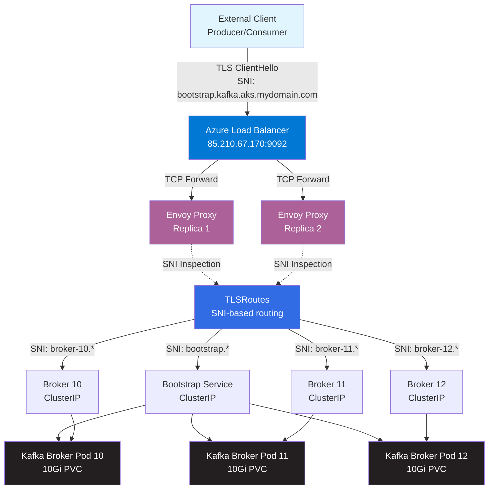

# Apache Kafka on AKS with Gateway API 🚀

[](https://azure.microsoft.com/en-us/products/kubernetes-service)
[](https://kubernetes.io/)
[](https://kafka.apache.org/)
[](https://strimzi.io/)
[](https://gateway.envoyproxy.io/)
[](https://www.python.org/)
[](LICENSE)

Production-grade Apache Kafka deployment on Azure Kubernetes Service (AKS) using **Strimzi Operator** and **Kubernetes Gateway API** with TLS passthrough. Includes complete Python test suite with mock producers and consumers using SASL/SCRAM-SHA-512 authentication.

---

## ✨ Key Features

- 🏗️ **Cloud-Native Architecture** — Kafka deployed on AKS with KRaft mode (no ZooKeeper)
- 🌐 **Gateway API Integration** — External access via Envoy Gateway with SNI-based TLS passthrough
- 🔒 **Enterprise Security** — End-to-end TLS encryption + SCRAM-SHA-512 authentication
- ⚡ **Cost-Optimized** — Single Azure Load Balancer serving all brokers via SNI routing
- 🎯 **Production-Ready** — 3 broker replicas with persistent storage on Azure Managed Disks
- 🧪 **Test Suite Included** — Python producer/consumer with realistic mock e-commerce events
- 📦 **GitOps-Ready** — Declarative YAML manifests for all components
- 🔄 **High Availability** — Multi-replica Envoy proxies, pod anti-affinity, PodDisruptionBudgets

---

## 📊 Architecture Overview



### 🔑 How It Works

1. **Client connects** to `bootstrap.kafka.aks.mydomain.com:9092` via Azure Load Balancer
2. **Envoy Gateway** inspects SNI hostname in TLS ClientHello (without decrypting)
3. **TLSRoute** matches SNI and routes to the correct Kafka broker's ClusterIP service
4. **Kafka returns metadata** with advertised hostnames for each broker
5. **Client reconnects** directly to specific broker (e.g., `broker-11.kafka.aks.mydomain.com`)
6. **Same routing flow** ensures connection reaches the correct broker pod

> 💡 **Why Gateway API?** — One LoadBalancer serves all brokers instead of 4 separate LBs ($72/mo vs $18/mo), using SNI for intelligent routing without terminating TLS.

---

## 🎯 Prerequisites

### Required Tools

| Tool | Version | Purpose |
|------|---------|---------|
| [Azure CLI](https://learn.microsoft.com/en-us/cli/azure/install-azure-cli) | Latest | Manage AKS cluster |
| [kubectl](https://kubernetes.io/docs/tasks/tools/) | 1.35+ | Kubernetes CLI |
| [Helm](https://helm.sh/docs/intro/install/) | 3.x | Package manager |
| [Python](https://www.python.org/downloads/) | 3.10+ | Test suite |
| [jq](https://jqlang.github.io/jq/download/) | Latest | JSON processing (for credential extraction) |

### Azure Resources

- **AKS Cluster** — Kubernetes 1.35+ with at least 2 nodes
- **Node Size** — Minimum `Standard_D2s_v3` (2 vCPU, 8GB RAM)
- **Network** — Azure CNI or kubenet with outbound connectivity
- **Storage** — Managed disks for Kafka persistent volumes

### Knowledge

- Basic Kubernetes concepts (Pods, Services, StatefulSets)
- Understanding of Kafka fundamentals (topics, partitions, brokers)
- Familiarity with TLS/SSL and SNI routing

---

## 🚀 Quick Start

### Step 1: Clone the Repository

```bash
git clone https://github.com/yourusername/kafka-strimzi-gateway-api.git
cd kafka-strimzi-gateway-api
```

### Step 2: Scale Your AKS Cluster (if needed)

```bash
# Ensure cluster has at least 2 nodes
az aks nodepool scale \
  --resource-group <YOUR_RG> \
  --cluster-name <YOUR_CLUSTER> \
  --name <NODEPOOL_NAME> \
  --node-count 2
```

### Step 3: Deploy Kafka Stack

```bash
cd aks-strimzi

# Full automated deployment (installs everything)
bash deploy-all.sh
```

**Or deploy step-by-step:**

```bash
# 1. Install prerequisites (Envoy Gateway, Cert-Manager, Strimzi)
bash 00-install-prerequisites.sh

# 2. Apply Gateway API resources
kubectl apply -f 01-gateway-class.yaml
kubectl apply -f 02-gateway.yaml

# 3. Create self-signed certificate
kubectl apply -f 03-certificate.yaml
kubectl wait --for=condition=Ready certificate/kafka-certificate -n strimzi --timeout=120s

# 4. Deploy Kafka NodePools and cluster
kubectl apply -f 04-kafka-node-pools.yaml
kubectl apply -f 05-kafka.yaml
kubectl wait kafka/gateway-api-kafka --for=condition=Ready --timeout=600s -n strimzi

# 5. Create TLS routes for SNI routing
kubectl apply -f 06-tls-routes.yaml

# 6. Create test user and topic
kubectl apply -f 07-user-and-topic.yaml
kubectl wait kafkauser/kafka-test-user --for=condition=Ready --timeout=120s -n strimzi
```

### Step 4: Get the Load Balancer IP

```bash
kubectl get svc -n envoy-gateway-system \
  -l gateway.envoyproxy.io/owning-gateway-name=kafka-gateway \
  -o jsonpath='{.items[0].status.loadBalancer.ingress[0].ip}'
```

### Step 5: Configure DNS

Add these entries to `/etc/hosts` (or your DNS server) using the LB IP from above:

```bash
# Replace 85.210.67.170 with your actual LB IP
sudo tee -a /etc/hosts <<EOF
85.210.67.170  bootstrap.kafka.aks.mydomain.com
85.210.67.170  broker-10.kafka.aks.mydomain.com
85.210.67.170  broker-11.kafka.aks.mydomain.com
85.210.67.170  broker-12.kafka.aks.mydomain.com
EOF
```

---

## 🧪 Testing Kafka Connectivity

### Extract Credentials

```bash
bash setup-credentials.sh
```

This creates `creds/` directory with:
- `ca.crt` — CA certificate for TLS verification
- `.env` — Environment variables for Python scripts
- `client.properties` — Config file for Kafka CLI tools

### Install Python Dependencies

```bash
pip install -r requirements.txt
```

### Run the Producer

```bash
# Send messages at 3/sec, 15 total
python3 producer.py --rate 3 --count 15
```

**Sample Output:**
```
Producer starting — topic=test-topic  rate=3.0/sec  count=15
Bootstrap: bootstrap.kafka.aks.mydomain.com:9092
------------------------------------------------------------
  SEND  #1       order=be971c8c  customer=CUST-9088  amount=$69.00  status=pending
  ACK   partition= 6  offset=1         [1 delivered]
  SEND  #2       order=6f82df4b  customer=CUST-8011  amount=$399.95  status=completed
  ...
Done — sent=15  delivered=15  failed=0
```

### Run the Consumer

```bash
# Read all messages from the beginning
python3 consumer.py --from-beginning
```

**Sample Output:**
```
Consumer starting — topic=test-topic  group=test-consumer-group  offset=earliest
------------------------------------------------------------------------------------------------------------------------
      #       Part:Offset    Time       Order        Customer     Product                Qty     Amount  Status
------------------------------------------------------------------------------------------------------------------------
  [+] #1      P 2: 2         13:11:37  order=6f82df4b    customer=CUST-8011   Wireless Headphones     qty=5  $  399.95  completed
  [!] #2      P 2: 3         13:11:39  order=7089e5f9    customer=CUST-2284   Coffee Maker            qty=2  $   99.98  refunded
  [~] #3      P 6: 1         13:11:37  order=be971c8c    customer=CUST-9088   Yoga Mat                qty=2  $   69.00  pending
  ...
```

> 📖 For detailed Python usage, see [`python.md`](python.md)

---

## 📁 Repository Structure

```
kafka-strimzi-gateway-api/
├── aks-strimzi/                          # Kubernetes manifests for AKS
│   ├── 00-install-prerequisites.sh       # Helm install script (Envoy, Cert-Manager, Strimzi)
│   ├── 01-gateway-class.yaml             # GatewayClass + EnvoyProxy (LoadBalancer config)
│   ├── 02-gateway.yaml                   # Gateway with TLS Passthrough
│   ├── 03-certificate.yaml               # Self-signed ClusterIssuer + Certificate
│   ├── 04-kafka-node-pools.yaml          # KRaft controller + broker node pools
│   ├── 05-kafka.yaml                     # Kafka cluster CR (KRaft mode)
│   ├── 06-tls-routes.yaml                # TLSRoutes for SNI-based routing
│   ├── 07-user-and-topic.yaml            # KafkaUser (SCRAM-SHA-512) + KafkaTopic
│   ├── 08-create-client-config.sh        # Legacy credential extractor (deprecated)
│   ├── deploy-all.sh                     # Automated full deployment
│   ├── aks-kafka.md                      # Quick reference guide
│   ├── aks-kafka-installation.md         # Detailed installation log
│   └── architecture.md                   # Deep-dive architecture documentation
│
├── strimzi-gateway-api/                  # Reference examples from Strimzi blog
│   └── (original KIND-based examples)
│
├── producer.py                           # Python mock producer (e-commerce events)
├── consumer.py                           # Python formatted consumer
├── setup-credentials.sh                  # Extract creds from K8s secrets
├── requirements.txt                      # Python dependencies
├── python.md                             # Python test suite documentation
├── README.md                             # This file
├── .gitignore                            # Protects secrets from being committed
└── creds/                                # Generated credentials (git-ignored)
    ├── ca.crt                            # CA certificate
    ├── .env                              # Environment variables
    └── client.properties                 # Kafka CLI config
```

---

## ⚙️ Configuration

### Key Settings

| Component | Setting | Value | Notes |
|-----------|---------|-------|-------|
| **Kafka** | Version | 4.1.0 | KRaft mode (no ZooKeeper) |
| | Brokers | 3 | IDs: 10, 11, 12 |
| | Controllers | 1 | ID: 0 |
| | Storage per pod | 10Gi | Azure Managed Disk (managed-csi) |
| | Replication Factor | 3 | For test-topic |
| | Partitions | 12 | For test-topic |
| **Gateway** | Protocol | TLS | Passthrough mode (no termination) |
| | Port | 9092 | Standard Kafka port |
| | Service Type | LoadBalancer | Azure LB with public IP |
| **Security** | Authentication | SCRAM-SHA-512 | SASL over TLS |
| | Authorization | Simple ACLs | Kafka's built-in authorizer |
| | TLS | Self-signed | Wildcard: `*.kafka.aks.mydomain.com` |

### Kafka Listener Configuration

```yaml
listeners:
- name: gateway
  port: 9092
  type: cluster-ip
  tls: true
  authentication:
    type: scram-sha-512
  configuration:
    createBootstrapService: true
    brokerCertChainAndKey:
      certificate: tls.crt
      key: tls.key
      secretName: kafka-certificate
    brokers:
    - broker: 10
      advertisedHost: broker-10.kafka.aks.mydomain.com
      advertisedPort: 9092
    # ... (brokers 11, 12)
```

### TLS Route Example

```yaml
apiVersion: gateway.networking.k8s.io/v1alpha2
kind: TLSRoute
metadata:
  name: kafka-broker-10
  namespace: strimzi
spec:
  hostnames:
  - broker-10.kafka.aks.mydomain.com
  parentRefs:
  - kind: Gateway
    name: kafka-gateway
    sectionName: kafka-listener
  rules:
  - backendRefs:
    - kind: Service
      name: gateway-api-kafka-broker-gateway-10
      port: 9092
```

---

## 🔐 Security Considerations

> ⚠️ **Production Checklist:**

- [ ] Replace self-signed certificate with Let's Encrypt or internal CA
- [ ] Implement network policies to restrict pod-to-pod traffic
- [ ] Configure Azure Private Link for private cluster access
- [ ] Enable Azure AD Workload Identity instead of service principals
- [ ] Rotate SCRAM-SHA-512 credentials periodically
- [ ] Restrict Kafka ACLs to specific topics/consumer groups per application
- [ ] Enable audit logging for Kafka broker events
- [ ] Configure backup strategy for Kafka persistent volumes
- [ ] Set resource limits and requests for all pods
- [ ] Enable pod security standards (restricted profile)

---

## 📚 Documentation

| Document | Description |
|----------|-------------|
| [`aks-strimzi/architecture.md`](aks-strimzi/architecture.md) | Detailed architecture explanation with ASCII diagrams |
| [`aks-strimzi/aks-kafka-installation.md`](aks-strimzi/aks-kafka-installation.md) | Step-by-step installation log with troubleshooting |
| [`aks-strimzi/aks-kafka.md`](aks-strimzi/aks-kafka.md) | Quick reference guide |
| [`python.md`](python.md) | Python test suite usage and configuration |
| [`scale_aks_nodes.md`](scale_aks_nodes.md) | AKS node scaling commands |

---

## 🛠️ Troubleshooting

### Common Issues

<details>
<summary><strong>🔴 Connection Refused / Timeout</strong></summary>

**Symptoms:**
```
ERROR: Local: Broker transport failure
```

**Fix:**
1. Verify DNS entries in `/etc/hosts`
2. Check Load Balancer IP:
   ```bash
   kubectl get svc -n envoy-gateway-system
   ```
3. Test connectivity:
   ```bash
   nc -zv bootstrap.kafka.aks.mydomain.com 9092
   ```
4. Check Envoy Gateway pods are running:
   ```bash
   kubectl get pods -n envoy-gateway-system
   ```

</details>

<details>
<summary><strong>🔴 SASL Authentication Failed</strong></summary>

**Symptoms:**
```
ERROR: SASL authentication failed
```

**Fix:**
1. Re-extract credentials:
   ```bash
   bash setup-credentials.sh
   ```
2. Verify user exists and is ready:
   ```bash
   kubectl get kafkauser kafka-test-user -n strimzi
   ```
3. Check credentials are correct:
   ```bash
   cat creds/.env | grep PASSWORD
   ```

</details>

<details>
<summary><strong>🔴 SSL Certificate Error</strong></summary>

**Symptoms:**
```
ERROR: SSL handshake failed
```

**Fix:**
1. Verify CA cert exists:
   ```bash
   ls -lh creds/ca.crt
   ```
2. Check certificate is valid:
   ```bash
   kubectl get certificate kafka-certificate -n strimzi
   ```
3. Re-extract if needed:
   ```bash
   bash setup-credentials.sh
   ```

</details>

<details>
<summary><strong>🔴 Kafka Cluster Not Ready</strong></summary>

**Symptoms:**
```
kubectl wait kafka/gateway-api-kafka --for=condition=Ready
# Timeout after 600s
```

**Fix:**
1. Check operator logs:
   ```bash
   kubectl logs -n strimzi -l strimzi.io/kind=cluster-operator --tail=100
   ```
2. Check broker pod status:
   ```bash
   kubectl get pods -n strimzi
   ```
3. Check entity operator logs:
   ```bash
   kubectl logs -n strimzi -l strimzi.io/name=gateway-api-kafka-entity-operator -c topic-operator
   ```
4. Verify CRDs are up-to-date (common issue):
   ```bash
   kubectl apply -f https://github.com/strimzi/strimzi-kafka-operator/releases/download/0.51.0/strimzi-crds-0.51.0.yaml
   ```

</details>

### Debug Commands

```bash
# Check all Kafka resources
kubectl get kafka,kafkanodepool,kafkatopic,kafkauser -n strimzi

# Check Gateway API resources
kubectl get gateway,gatewayclass,tlsroutes -n strimzi

# Check services and endpoints
kubectl get svc,endpoints -n strimzi

# View Kafka broker logs
kubectl logs -n strimzi gateway-api-kafka-broker-10 --tail=100

# Describe Gateway for status
kubectl describe gateway kafka-gateway -n strimzi

# Check certificate status
kubectl describe certificate kafka-certificate -n strimzi
```

---

## 🧹 Cleanup

### Remove Kafka Resources

```bash
kubectl delete -f aks-strimzi/07-user-and-topic.yaml
kubectl delete -f aks-strimzi/06-tls-routes.yaml
kubectl delete -f aks-strimzi/05-kafka.yaml
kubectl delete -f aks-strimzi/04-kafka-node-pools.yaml
kubectl delete -f aks-strimzi/03-certificate.yaml
kubectl delete -f aks-strimzi/02-gateway.yaml
kubectl delete -f aks-strimzi/01-gateway-class.yaml
```

### Uninstall Helm Releases

```bash
helm uninstall strimzi-kafka-operator -n strimzi
helm uninstall cert-manager -n cert-manager
helm uninstall envoy-gateway -n envoy-gateway-system
```

### Delete Namespaces

```bash
kubectl delete namespace strimzi cert-manager envoy-gateway-system
```

### Remove Gateway API CRDs

```bash
kubectl delete -f https://github.com/kubernetes-sigs/gateway-api/releases/download/v1.2.0/experimental-install.yaml
```

---

## 🤝 Contributing

Contributions are welcome! Please follow these guidelines:

1. **Fork the repository** and create a feature branch
2. **Test your changes** on a real AKS cluster
3. **Update documentation** if you change manifests or scripts
4. **Follow conventions**:
   - Use 2-space indentation in YAML
   - Prefix commit messages with type (`feat:`, `fix:`, `docs:`, `chore:`)
   - Add comments for non-obvious configuration

### Reporting Issues

Please include:
- Kubernetes version (`kubectl version`)
- Strimzi version (`helm list -n strimzi`)
- Error logs (`kubectl logs ...`)
- Steps to reproduce

---

## 📄 License

This project is licensed under the **MIT License** — see the [LICENSE](LICENSE) file for details.

---

## 🙏 Acknowledgments

- **[Strimzi](https://strimzi.io/)** — Kafka on Kubernetes operator
- **[Envoy Gateway](https://gateway.envoyproxy.io/)** — Kubernetes Gateway API implementation
- **[Gateway API](https://gateway-api.sigs.k8s.io/)** — Next-generation Ingress/routing API
- **[Azure AKS](https://azure.microsoft.com/en-us/products/kubernetes-service)** — Managed Kubernetes service
- **Strimzi Blog Post**: ["Accessing Kafka with Gateway API"](https://strimzi.io/blog/2024/08/16/accessing-kafka-with-gateway-api/) — Original inspiration

---

## 📧 Contact & Support

- **Issues**: [GitHub Issues](https://github.com/yourusername/kafka-strimzi-gateway-api/issues)
- **Discussions**: [GitHub Discussions](https://github.com/yourusername/kafka-strimzi-gateway-api/discussions)

---

<div align="center">

**⭐ If this project helped you, please give it a star! ⭐**

Made with ❤️ by the Cloud Native Community

</div>
